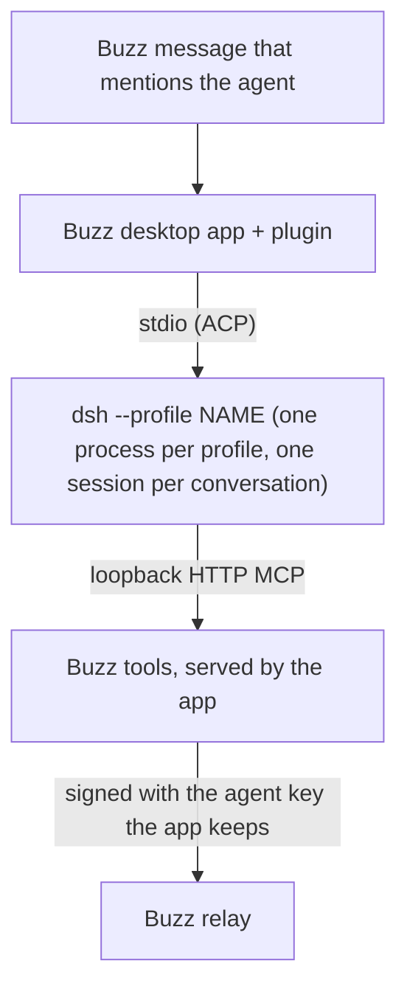

# buzz-plugin-dsh

Run [DeepSeek Harness](https://github.com/deepseek-ai/deepseek-harness) (`dsh`)
agents in the Buzz desktop app. The plugin `sagmans.dsh` adds the agent type
"DSH". Each conversation of a DSH agent is one dsh ACP session on your
computer, with the provider and model that the dsh profile is set up with.

## What it does



- The turn logic is the Buzz app's own Goose runtime and shared ACP client,
  bundled unchanged. A DSH agent therefore acts as a Goose agent does: the
  same sessions, per-thread or per-channel scope, watches, wakes, Solo, Stop
  and reply rules. A turn has no time limit of its own.
- dsh answers with all the Buzz tools (`send`, `read`, memory, canvas,
  watches and others). The app serves them to each session over loopback
  HTTP MCP, with one token per session. The agent key stays in the app; dsh
  never gets it.
- Only the owner, or an identity the owner delegated to, can start a turn
  with a mention. dsh runs commands as you, so other mentions are ignored.
- The New agent dialog and the Settings tab list the models and efforts that
  the profile offers. You can pick another model or effort for one message.
  They use the app's own model picker, instructions field and settings rows,
  so a DSH agent looks as the app's own agents do.
- The Activity tab shows each session's transcript and tool calls from dsh's
  own session files, also for sessions from before this plugin. The app's
  usage view shows token use (with the bundle). The plugin's local record shows
  a turn as it streams. The record stays in the app's local storage and never
  holds a session's token.

## Requirements

- The Buzz desktop app, version 0.7.0-preview.243.1 (see "Compatibility").
- `dsh` (verified with 0.2.1-rc.2) with its `buzz` profile and a provider set
  up in it: see "The `buzz` profile". Check it in a terminal:
  `dsh --profile buzz --help`.
- `dsh` and `node` on the app's search path. A macOS app does not read your
  shell profile. Buzz searches the Homebrew folders and `~/.local/bin`. If
  `dsh` comes from a version manager, link it, for example:
  `ln -s "$(command -v dsh)" ~/.local/bin/dsh` (and the same for `node`).

## Install

1. Build the plugin (see "Build"). The output is `dist/manifest.json` and
   `dist/plugin.js`.
2. In the Buzz desktop app, install the plugin from the `dist/` folder.
3. Create an agent of the type "DSH", or keep your saved ones: they carry
   over with their settings and sessions.
4. Mention the agent in a channel.

The plugin asks for these host grants (`plugin/manifest.json`):

| Grant | Why |
| --- | --- |
| Process `dsh --profile` | Starts dsh. No other program. The only other argument is the profile name, which must match `PROFILE_RE`. |
| `mcp` | Serves the Buzz tools to dsh on a loopback port, with a token. |
| `files` | Lets the Buzz tools attach files from the agent's workspace. |

## Settings

| Setting | Default | Effect |
| --- | --- | --- |
| Model | Default of the dsh profile | A model that dsh offers. |
| Reasoning effort | Default | `off`, `low`, `high` or `max`, when the model has levels. |
| Instructions | Empty | Added to the Buzz system prompt of each new session. |
| dsh profile | `buzz` | The dsh profile to start. Lowercase letters, digits, `-` and `_`. |
| Workspace | `~/dsh-agents` | The folder dsh works in. Absolute, or starts with `~/`. |
| Sessions | One per thread | One session per thread, or one per channel. |

A model or effort change applies at the next turn. A workspace or profile
change opens a new session at the next idle turn.

## The `buzz` profile

Buzz agents run on their own dsh profile, `buzz`. Your other dsh profiles do not
need the Buzz bundle, and this plugin does not change them. The profile holds
dsh's ACP server, the bundle below, and your provider. Make it once:

```sh
scripts/setup-buzz-profile
```

The script refuses to run when the profile exists. It also turns off the session
log upload, the package list upload and the OTel session export. Then add your
provider to `$DSH_HOME/profiles/buzz/cordis.patch.yml` (default `DSH_HOME` is
`~/.dsh`), on the `acp-buzz` row and the provider row. Keep each key in the
environment, not in that file.

Without the profile, dsh stops at the start of a turn and says that the profile
does not exist.

## The dsh bundle (steering, compaction, usage)

`dsh-acp-buzz/` is a dsh profile bundle. You add it to the dsh profile, not to
Buzz. `scripts/setup-buzz-profile` adds it to the `buzz` profile. An agent that
you set to another profile needs it there too.
[dsh-acp-buzz/README.md](dsh-acp-buzz/README.md) has the protocol.

```sh
dsh plugin --profile <profile> add link:/path/to/buzz-plugin-dsh/dsh-acp-buzz
```

The plugin asks each dsh process right after `initialize`: it calls
`_dsh/session/steer` with invalid params. `-32602` means that the bundle is
present, and `-32601` means that it is absent. The provider dialog shows the
answer per profile, with the command for your profile.

| Feature | With the bundle | Without it |
| --- | --- | --- |
| A message during a turn | Goes into the running turn. A refused steer runs as the next turn. | Waits for the next turn. |
| Compact | Runs dsh's own compaction, with no model turn. | Refused with the add command. `/compact` never reaches the model, because it would be a paid turn. |
| Token use | Recorded per turn. | Not recorded. |

## Security

- dsh runs its tools (shell, file edits) with your own access, with no
  sandbox. The client answers each dsh permission request with "allow once".
  The plugin removes dsh's lasting grant from the choices first
  (`src/dsh.ts`, `DshWire`), because the shared client prefers a lasting one.
- A mention starts a turn only with your authority, by the same rule as the
  agents that come with Buzz: your own signed mention, or a mention from one
  of your agents whose `auth` tag (NIP-OA) you signed. Plugin and Attention
  wakes from this app are framed as data.
- The plugin passes no secret to dsh. dsh reads its own provider keys. The
  Buzz identity is removed from its environment.

## Limits

- Buzz draws icons only for its bundled plugins, so this plugin adds its own to
  its row and details panel in Settings, by editing that page. The build checks
  the page at the pinned app revision. If a newer app changes the page, the app's
  generic icon comes back; nothing else breaks.
- dsh has no `session/load`. After a restart the plugin uses
  `session/resume`, which restores the session with no replay. When dsh can
  no longer resume it, the conversation goes on in a new session.
- dsh has no system-prompt extension in ACP. The Buzz system prompt goes at
  the head of the first prompt of a session, and again after a resume. A
  resumed conversation therefore costs some extra tokens.
- Reading the model list opens a throwaway session with no tools and closes
  it. dsh keeps an empty session folder for each read.
- A dsh request other than a prompt must answer in 60 seconds, or the shared
  client stops the process. A real dsh starts in less than 2 seconds.
- The Activity tab reads dsh's session files under `~/.dsh/sessions`: the latest
  50 turns of a conversation, from up to 10 of its sessions, as the app's own
  agents show. It lists the sessions whose first prompt names the agent, from
  the newest 500 sessions in the agent's workspace. A session with no readable
  file shows from the plugin's record, which keeps the latest 50 turns of a
  conversation and at most 1 MB per agent. That is also what shows when
  `DSH_HOME` moves dsh's home, because a plugin cannot read the environment.
- A session's order in the list comes from its last event in the file. Token use
  comes from the record only, so a session from before the record shows no use.
- A session with no title shows as a short id, because the plugin API does not
  give channel names to the Activity tab.
- An open transcript replaces the Activity tab's content, with a back button.
  The app's own agents open it in a panel tab. The plugin API does not give
  that part of the app to plugins.
- The Activity tab does not load remote images in a transcript.
- An agent cannot set a static WebP picture that needs a pixel change. The app
  does that work in a web worker, and an installed plugin is one file. The tool
  tells the agent to use a PNG or JPEG. PNG, JPEG and GIF work.
- The Settings tab does not warn about unsaved changes when you leave it.
  The plugin API does not give that part of the app to plugins.

## Supply chain

Every package in the bundle and in the build comes from this repository's
lockfile. The release-age guard in `pnpm-workspace.yaml` and the pre-push
dependency scan judge that lockfile, so they cover the whole build. The buzz-app
clone gives source only and has no install of its own.

## Compatibility

The plugin bundles modules of the Buzz app at one revision
(`BUZZ_APP_REV` in `scripts/build-plugin.mjs`):
`56729773f48d3f922a043ac83b7faa727bcfc9c2`, the revision of
Buzz Desktop 0.7.0-preview.243.1. A new app release can change these modules.
Before you use the plugin with a newer app, move the pin to that release,
then build and run `scripts/check`.

## Build

You need Node.js 24 or newer, pnpm and a buzz-app clone at the pinned revision.
The clone needs no install: the build uses this repository's Vite, TypeScript
and Biome.

```sh
git clone https://github.com/block/buzz-app.git <clone>
git -C <clone> checkout 56729773f48d3f922a043ac83b7faa727bcfc9c2
scripts/link-toolchain <clone>      # makes the gitignored buzz-app link
pnpm install --frozen-lockfile --ignore-scripts
node scripts/build-plugin.mjs       # type check, then dist/
```

The build fails when the clone is at another revision, has local edits to a
tracked file, or when the bundle would hold a module that must stay the app's own
(a React renderer, Tauri, the agent service or identity code). React itself
comes from the app at run time (`src/react-host.ts`).

## Checks

Run `scripts/setup-hooks` once after you clone. Install the tools in
`mise.toml` (`mise install`), plus `gitleaks`, `shellcheck`, `lizard`,
`semgrep` and `trivy`.

- `scripts/check --quick`: syntax, manifest grant, format and lint, private
  data guard. The pre-commit hook runs it.
- `scripts/check`: all of the above, then Markdown lint, complexity, semgrep,
  trivy, the build, the smoke run and the bundle's smoke run. The pre-push
  hook runs it on each pushed commit.
- `node smoke/run.mjs --plugin dist`: the built plugin against
  `scripts/fake-acp.mjs`, a stand-in that answers as dsh does with and without
  the bundle. It needs no dsh and makes no model call.

A real dsh takes two more runs. Each needs `DSH_HOME` set explicitly, because
each run writes session folders in that home:

- `--real-dsh <profiles>` starts a real dsh for the comma-separated profiles,
  reads the models and the bundle state, and prints the provider dialog. It
  makes no model call, and it fails if a prompt reached dsh.
- `--real-dsh <profile> --live-turn` also runs short real turns: an answer
  through `send`, and with the bundle a steer, a compaction and the usage
  record. **This costs money**, so no check runs it. Run it once after you
  change the turn, steering or compaction code, and on each new dsh version.
- `--model <value>` and `--effort <value>` choose what the real turns run on,
  because a profile default can be another provider. `--skip-plain-turn` leaves
  out the answer through `send`, for a rerun that already proved it.

Never use `--no-verify`.

## License

Apache License 2.0. See `LICENSE` and `NOTICE`.
